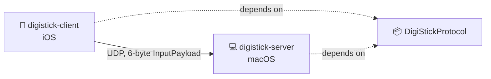

<h1 align="center">📦 DigiStickProtocol</h1>

<p align="center">
  The shared wire format for DigiStick,<br>
  a virtual gamepad system for iOS and macOS.
</p>

<p align="center">
  
  
  
  
  
</p>

<p align="center">
  <a href="#-overview">Overview</a> •
  <a href="#-installation">Installation</a> •
  <a href="#-usage">Usage</a> •
  <a href="#-wire-format">Wire Format</a> •
  <a href="#-versioning">Versioning</a> •
  <a href="#-development">Development</a>
</p>

---

## 📖 Overview

This Swift package is the single source of truth for the bytes exchanged between the DigiStick iOS client and the macOS server. It has no dependencies and imports only `Foundation`, so it builds on both platforms.



## 📥 Installation

Requires Swift 5.9+, iOS 17+, or macOS 14+.

Add the package to your `Package.swift`:

```swift
dependencies: [
    .package(url: "https://github.com/<your-username>/digistick-protocol.git", from: "1.0.0")
],
targets: [
    .target(
        name: "YourTarget",
        dependencies: [
            .product(name: "DigiStickProtocol", package: "digistick-protocol")
        ]
    )
]
```

In Xcode, use **File → Add Package Dependencies…** and enter the repository URL.

## 🚀 Usage

```swift
import DigiStickProtocol

// Encode (client)
let payload = InputPayload(x: 12_000, y: -4_000, buttons: 0b0000_0001)
let packet: Data = payload.data   // 6 bytes, ready to send over UDP

// Decode (server)
do {
    let received = try InputPayload(data: packet)
    print(received.x, received.y, received.buttons)
} catch InputPayload.DecodingError.invalidLength(let expected, let actual) {
    // Wrong packet size
} catch InputPayload.DecodingError.unsupportedVersion(let version) {
    // Sender speaks a different protocol version
}
```

## 📐 Wire Format

Protocol version `1`. Each packet is exactly 6 bytes. All multi-byte fields are little-endian. There is no padding.

| Offset | Size | Field     | Type    | Description                           |
|:------:|:----:|-----------|---------|---------------------------------------|
| 0      | 1    | `version` | `UInt8` | Protocol version. Must be `0x01`.     |
| 1      | 2    | `x`       | `Int16` | Horizontal axis, `-32768` to `32767`. |
| 3      | 2    | `y`       | `Int16` | Vertical axis, `-32768` to `32767`.   |
| 5      | 1    | `buttons` | `UInt8` | Button bitmask. Bit 0 is button 1.    |

Every field is encoded byte by byte. The format does not depend on Swift's in-memory struct layout or on the host's endianness.

### 🧪 Test Vectors

The unit tests assert these exact byte sequences. Any implementation of the protocol should produce and accept the same bytes.

| Case                      | `x`      | `y`      | `buttons` | Bytes (hex)         |
|---------------------------|----------|----------|-----------|---------------------|
| Centered, no buttons      | `0`      | `0`      | `0x00`    | `01 00 00 00 00 00` |
| Small values, two buttons | `1`      | `-1`     | `0x03`    | `01 01 00 FF FF 03` |
| Extremes, all buttons     | `32767`  | `-32768` | `0xFF`    | `01 FF 7F 00 80 FF` |
| Endianness check          | `0x1234` | `0x5678` | `0x9A`    | `01 34 12 78 56 9A` |

## 🔖 Versioning

Two version numbers are involved:

- **Protocol version:** the first byte of every packet. A decoder rejects any packet whose version it does not support.
- **Package version:** follows [Semantic Versioning](https://semver.org). Package `1.x` speaks protocol version `1`.

> [!IMPORTANT]
> Any change to the byte layout (adding, removing, resizing, or reordering a field) is a breaking change. It requires a new protocol version byte and a new major package version.

## 🔧 Development

Run the tests:

```bash
swift test
```

When changing the format:

1. Update `InputPayload` and increment `protocolVersion`.
2. Update the table and test vectors in this README.
3. Update the vectors in `InputPayloadTests`.
4. Tag a new major version.

## 🔗 Related Repositories

| Repository                                                                  | Description                                                  |
|-----------------------------------------------------------------------------|--------------------------------------------------------------|
| [digistick-server](https://github.com/<your-username>/digistick-server)     | macOS command-line tool that receives packets and creates a virtual gamepad |
| [digistick-client](https://github.com/<your-username>/digistick-client)     | iOS app that captures touch input and sends packets          |

---

> 🤖 This project was developed with AI assistance from [Google Gemini](https://gemini.google.com) and [Claude](https://claude.ai).